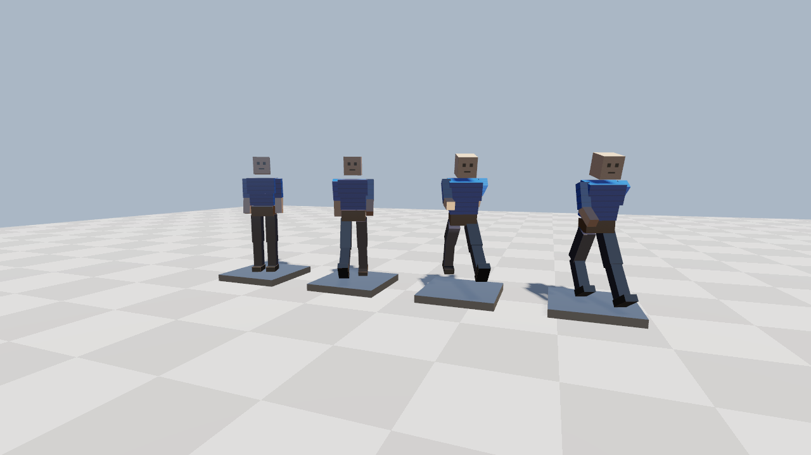
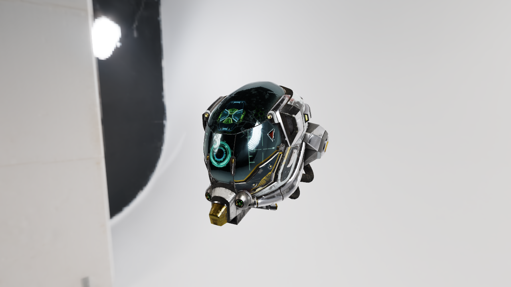

# Ron

**A compiled programming language for 3D games, built completely from scratch.**


`ronc` turns `.ron` source files into native Windows x86-64 executables. There is no LLVM,
no external assembler and no external linker: the compiler allocates registers, encodes every
machine instruction itself and writes the PE (`.exe`) file byte by byte. Games link against
`ron_engine.dll`, a Vulkan renderer with physically based materials, textures, shadows and
skeletal animation.

```ron
import "std/io.ron";
import "std/option.ron";

enum Shape { Circle(float), Rect(float, float) }

fn area(Shape s) -> float {
    match (s) {
        Circle(r) => return 3.14159 * r * r;
        Rect(w, h) => return w * h;
    }
}

fn find(int[] xs, int target) -> Option<int> {
    for (var i in 0..xs.len)
        if (xs[i] == target) return Option::Some(i as int);
    return Option::None;
}

fn main() -> int {
    var shapes = [Shape::Circle(1.0), Shape::Rect(2.0, 3.0)];
    for (var s in shapes) println("area: {:.2}", area(s));
    println("found at {}", find([4, 8, 15], 15).unwrap_or(-1));
    return 0;
}

test "areas" { assert(area(Shape::Rect(2.0, 2.0)) == 4.0); }
```

## Features

**Language** ([reference](docs/LANGUAGE.md), [tutorial](docs/TUTORIAL.md))
- structs, enums, pointers, arrays, **slices**, type inference (`var`)
- **generics** (`List<T>`, `fn max<T>(T a, T b)`), overloading, operator overloading, method syntax
- **sum types** and `match`, `Option<T>` / `Result<T, E>` with the `?` operator
- **function values** and callbacks, **variadics** (`..Any`) with runtime type information
- `switch`, `defer`, `for (x in items)`, ranges, labeled loops, array and named struct literals
- **modules** with `private` and `import "x.ron" as m;`, computed global initializers
- built-in **tests** (`test "name" { ... }`), `assert`, `panic`

**Compiler** (`src/`, C++20, no dependencies)
- lexer, recursive-descent parser with error recovery, `file:line:col` diagnostics and warnings
- semantic analysis with monomorphized generics, overload resolution and constant folding
- **register allocation**, SIB addressing, immediates, branch fusion, loop alignment
- x86-64 encoder and PE32+ writer: a complete game is a ~50 KB `.exe`
- default builds check array/slice bounds and print **stack traces** on crashes (`--release` disables checks)
- dead-code elimination, live reload (`ronc run --watch`)

| benchmark (`examples/benchmark.ron`) | Ron `--release` | C, MSVC `/O2` |
|---|---|---|
| fib(32) + sieve(20M) + n-body | ~1.1-1.3x the C time | 1x |

**Standard library** (`std/`, written in Ron): `String`, `List<T>`, `Map<K, V>`, formatting
(`println("{} hp", hp)` prints any type, structs included), math with vectors and matrices,
files and directories, command-line arguments, threads, mutexes and atomics, random numbers,
time, rigid-body physics, an entity component system, audio.

**Engine** (`engine/`, C++ + Vulkan): 4x MSAA, shadow mapping with PCF, GGX physically based
shading with metallic-roughness, normal, occlusion and emissive maps, image-based lighting from
HDR environments (prefiltered on the CPU), PNG, baseline/progressive JPEG and Radiance HDR
decoders written from scratch, glTF 2.0 models, GPU skinning with animation blending, morph
targets (blend shapes) for facial animation, alpha-to-coverage and blended transparency (hair),
a subsurface-scattering approximation for skin and an anisotropic hair highlight, fog, ACES tone
mapping, input, a software audio synthesizer.





*[DamagedHelmet](https://github.com/KhronosGroup/glTF-Sample-Assets/tree/main/Models/DamagedHelmet)
(CC-BY 4.0, theblueflame / ctxwing) lit by the CC0 [studio_small_09](https://polyhaven.com/a/studio_small_09)
HDRI, viewed with `ronc run examples/model_viewer.ron -- DamagedHelmet.glb studio_small_09_1k.hdr`.*

## Getting started

Download `ron-0.1.0-windows-x64.zip` from the [releases](https://github.com/junior10-afk/ron-lang/releases),
unzip it, and run:

```powershell
.\ronc.exe new mygame
.\ronc.exe run mygame\main.ron
.\ronc.exe test mygame\main.ron
.\ronc.exe run examples\arena.ron        # the demo game (WASD, Shift, Space, click, right mouse)
```

Syntax highlighting for VS Code is in `editors/vscode`.

### Building from source

Requirements: Windows 10/11 x64, Visual Studio 2022 Build Tools (MSVC + CMake), the
[Vulkan SDK](https://vulkan.lunarg.com/) for the engine.

```powershell
.\build.ps1 -Release        # ronc, ron_engine.dll, and all tests (C++ unit/e2e, asset, Ron std tests)
.\package.ps1               # release zip in build/
```

## ronc

```
ronc build game.ron [-o game.exe] [--gui] [--release] [--Werror]
ronc run   game.ron [--watch] [-- args...]
                                    build and run; --watch rebuilds and restarts on every save;
                                    arguments after -- are passed to the program
ronc test  game.ron                 run the file's test blocks
ronc check game.ron                 type-check only
ronc new   folder                   create a project
ronc --version
```

## Project layout

```
src/        compiler: lexer, parser, sema, register allocator + x86-64 codegen, PE writer, driver
std/        standard library and runtime, written in Ron
engine/     ron_engine.dll: window, input, Vulkan renderer, shaders, PNG/JPEG/HDR + glTF loaders,
            image-based lighting, audio
examples/   arena.ron, character_viewer.ron, model_viewer.ron, spinning_cube.ron, benchmark.ron
assets/     character.glb (generated by tools/make_character.cpp)
editors/    VS Code extension
tests/      C++ unit and end-to-end tests, asset tests, Ron tests (tests/ron)
docs/       language reference, tutorial, design notes
```

## How it works

```
source.ron ─► Lexer ─► Parser ─► AST ─► Sema ─► Register allocation + x86-64 CodeGen ─► PE writer ─► game.exe
                                                                                                       │
                                               ron_engine.dll (C++ / Vulkan) ◄────── imports ─────────┘
```

Sema produces a fully typed AST (generic code is instantiated per type, `for-in` loops are
lowered to indexed loops). The code generator keeps hot variables in callee-saved registers,
follows the Windows x64 calling convention, and emits function/line tables that the runtime
(`std/runtime.ron`) uses for stack traces. See [docs/PLAN.md](docs/PLAN.md).

## License

[MIT](LICENSE)
