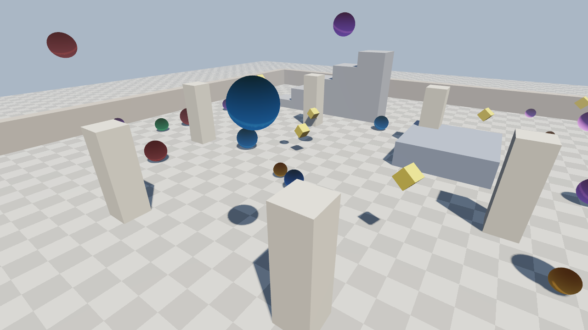

# Ron

**A compiled programming language for 3D games, built completely from scratch.**



`ronc` turns `.ron` source files into native Windows x86-64 executables. There is no LLVM,
no external assembler and no external linker: the compiler encodes every machine instruction
itself and writes the PE (`.exe`) file byte by byte. Games link against `ron_engine.dll`, a
Vulkan renderer with shadows, MSAA and tone mapping.

```ron
import "std/engine.ron";

fn main() -> int {
    engine_init(1280, 720, "Hello Ron");
    int cube = engine_mesh_cube();
    OrbitCamera cam = orbit_camera(vec3(0.0, 0.0, 0.0), 5.0);

    while (engine_running()) {
        cam.update();
        cam.apply();
        float t = engine_time() as float;
        if (engine_begin_frame(0.45, 0.55, 0.7)) {
            Mat4 model = mat4_rotate_y(t) * mat4_rotate_x(t * 0.5);
            engine_draw(cube, &model, 0.9, 0.35, 0.2);
            engine_end_frame();
        }
    }
    engine_shutdown();
    return 0;
}
```

## Features

**Language**: C-style syntax, structs, enums, pointers, fixed arrays, function overloading,
operator overloading, method-call syntax (`v.length()`), untyped numeric literals, `const`,
modules with `import`, direct calls into any Windows DLL. See the
[language reference](docs/LANGUAGE.md).

**Compiler** (`src/`, ~5k lines of C++20, no dependencies):
- lexer with UTF-8 identifiers and precise diagnostics (`file:line:col` + caret)
- recursive-descent parser with error recovery
- semantic analysis: type checking, overload resolution, implicit conversions, constant folding
- x86-64 machine code encoder and code generator (Win64 ABI, SSE floating point)
- PE32+ writer with import tables: a complete game is a ~40 KB `.exe`
- dead-code elimination and live reload (`ronc run --watch`)

**Engine** (`engine/`, C++ + Vulkan):
- forward renderer, 4x MSAA, depth buffer, directional shadow mapping with PCF
- hemispheric ambient + Blinn-Phong lighting, fog, ACES tone mapping, sRGB output
- procedural meshes (cube, sphere, plane) and custom meshes
- keyboard and mouse input, GPU screenshots
- software audio synthesizer (sine / square / saw / noise voices)

**Standard library** (`std/`, written in Ron): I/O, strings, memory, math with vectors
and matrices, random numbers, time, rigid-body physics, an entity component system and
sound effects.

## Getting started

Requirements: Windows 10/11 x64, Visual Studio 2022 Build Tools (MSVC + CMake),
the [Vulkan SDK](https://vulkan.lunarg.com/) for the engine.

```powershell
.\build.ps1 -Release                                   # builds ronc, the engine and runs the tests
.\build\Release\ronc.exe run examples\arena.ron        # play the demo game
```

Arena controls: WASD to move, Space to jump, Shift to sprint, F to shoot, right mouse to orbit
the camera, mouse wheel to zoom, R to reset, Esc to quit.

## ronc

```
ronc build game.ron [-o game.exe] [--gui]   compile to a native executable
ronc run   game.ron [--watch]               compile and run; --watch rebuilds on every save
ronc check game.ron                         type-check only
ronc tokens game.ron                        print the lexer's tokens
```

## Project layout

```
src/        compiler: lexer, parser, sema, x86-64 encoder, codegen, PE writer, driver
engine/     ron_engine.dll: window, input, Vulkan renderer, shaders, audio
std/        standard library, written in Ron
examples/   spinning_cube.ron, arena.ron
tests/      unit + end-to-end tests (compile Ron programs, run them, check the output)
docs/       language reference, implementation plan
```

## How it works

```
source.ron ─► Lexer ─► Parser ─► AST ─► Sema ─► x86-64 CodeGen ─► PE writer ─► game.exe
                                                                                  │
                                    ron_engine.dll (C++ / Vulkan) ◄── imports ────┘
```

The code generator is a single pass over the typed AST. Expression results live in `rax`
or `xmm0`, temporaries in stack slots, and every call follows the Windows x64 calling
convention, so Ron functions, the engine and Windows itself call each other directly.
See [docs/PLAN.md](docs/PLAN.md) for the design decisions.

## Status and limits

Ron 0.1 is a working foundation, not a finished AAA toolchain. The code generator does no
register allocation or optimization beyond constant folding, so it is slower than C. The
language has no generics, closures or dynamic strings yet, and the renderer has no textures,
skeletal animation or PBR materials. These are the natural next steps.
